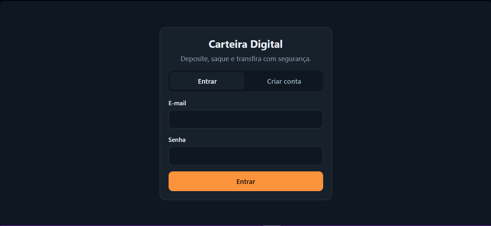
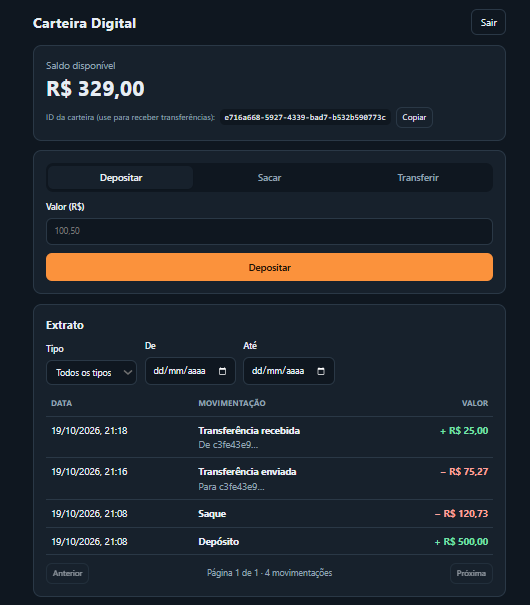
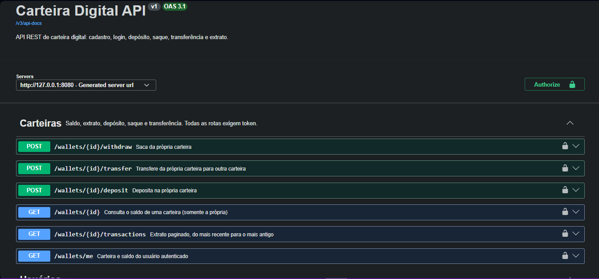
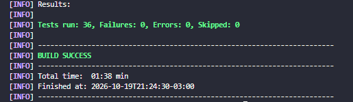

# Carteira Digital

API REST de carteira digital: o usuário cria uma conta, deposita, saca e transfere dinheiro para outros usuários, e consulta o extrato. O foco do projeto é **consistência financeira**: saldo nunca negativo, histórico imutável e transferências seguras mesmo com requisições simultâneas.

**Status:** funcional, com todos os itens do roadmap concluídos.

## Demonstração

| Login | Painel (saldo, operações e extrato) |
|---|---|
|  |  |

| Documentação interativa (Swagger) | Testes automatizados |
|---|---|
|  |  |

## Stack

Java 21 · Spring Boot · Spring Data JPA · Spring Security (JWT) · PostgreSQL · Flyway · Docker Compose · JUnit 5 · Testcontainers · OpenAPI/Swagger

**Front-end:** React · TypeScript · Vite

## Como rodar

Pré-requisitos: JDK 21+, Maven e Docker.

```bash
# 1. subir o PostgreSQL (porta 5433 no host)
docker compose up -d

# 2. rodar a aplicação (o Flyway cria as tabelas na primeira execução)
mvn spring-boot:run

# 3. conferir se subiu
curl http://localhost:8080/actuator/health
```

A resposta esperada é `{"status":"UP"}`. A configuração do banco pode ser trocada pelas variáveis `DB_URL`, `DB_USER` e `DB_PASSWORD`. O segredo do JWT vem de `JWT_SECRET`; o valor padrão do `application.yml` serve **apenas para desenvolvimento**.

## Rodando tudo com Docker

Um comando sobe o banco, a API e o front-end (precisa só do Docker):

```bash
docker compose up --build
```

| Serviço | Endereço |
|---|---|
| Front-end | http://localhost:3000 |
| API e Swagger | http://localhost:8080/swagger-ui.html |
| PostgreSQL (a partir da sua máquina) | `localhost:5433` |

A primeira execução demora alguns minutos porque baixa as imagens e compila os dois projetos. Pare qualquer `mvn spring-boot:run` ou `npm run dev` antes, porque a porta 8080 é a mesma. Para encerrar use `docker compose down` (os dados continuam salvos) ou `docker compose down -v` (apaga também o banco).

Para desenvolver sem containers de aplicação, suba só o banco com `docker compose up -d db` e rode a API e o front pelos passos abaixo. As senhas e o segredo do JWT que aparecem no `docker-compose.yml` são apenas para desenvolvimento.

## Front-end

Interface em React + TypeScript (Vite), na pasta `frontend/`: cadastro e login, saldo, depósito, saque, transferência e extrato com filtros e paginação.

```bash
cd frontend
npm install
npm run dev
```

Abra `http://localhost:5173` com a API rodando na porta 8080 (requer Node 20.19+ ou 22.12+). O servidor de desenvolvimento do Vite repassa as chamadas de `/api` para o back-end, então não há problema de CORS.

Para testar uma transferência, abra duas abas do navegador: o token fica no `sessionStorage`, então cada aba pode ter um usuário diferente logado. Copie o ID da carteira de um usuário (botão **Copiar**) e use como destino no outro.

## Modelo de dados

```
users 1 ──── 1 wallets 1 ──── N transactions
                 (saldo)        (origem e/ou destino)
```

| Tabela | Observação |
|---|---|
| `users` | email único; senha guardada apenas como hash |
| `wallets` | uma por usuário; `balance NUMERIC(19,2)` com `CHECK (balance >= 0)`; coluna `version` para lock otimista |
| `transactions` | tipos `DEPOSIT`, `WITHDRAWAL` e `TRANSFER`; imutável (trigger bloqueia UPDATE/DELETE) |

## Decisões de projeto

- **Dinheiro em `BigDecimal` / `NUMERIC(19,2)`**, nunca `double`.
- **Regras também no banco**: saldo não negativo, valor positivo e coerência origem/destino por tipo ficam em `CHECK`, como segunda linha de defesa além do código.
- **Histórico imutável**: correções são feitas com novas transações, nunca editando as antigas.
- **Idempotência**: índice único por (carteira, `idempotency_key`) para que um reenvio não duplique a operação.
- **Extrato**: paginado (`page`/`size`, máximo 100 por página), do mais recente para o mais antigo, com filtro por tipo e por período (`from`/`to` inclusivos, no fuso de São Paulo). Cada item traz `direction` (`CREDIT` ou `DEBIT`) do ponto de vista da carteira consultada.
- **Autenticação stateless com JWT** (HS256, Spring Security OAuth2 Resource Server): o login devolve um token com o id do usuário e validade de 1 hora; senhas são guardadas com BCrypt. A mensagem de erro do login é a mesma para e-mail inexistente e senha errada.
- **Concorrência**: toda operação trava a(s) carteira(s) com `SELECT ... FOR UPDATE` (lock pessimista) antes de mexer no saldo, então requisições simultâneas na mesma carteira são serializadas. Na transferência as duas carteiras são travadas sempre em ordem de id, o que evita deadlock em transferências cruzadas (A para B e B para A ao mesmo tempo). O `@Version` fica como rede de segurança.
- **Teste de concorrência manual**: com a aplicação rodando, `powershell -ExecutionPolicy Bypass -File .\scripts\teste-concorrencia.ps1` dispara requisições simultâneas e confere saldos e códigos HTTP.
- **Schema versionado com Flyway**; o Hibernate roda em `ddl-auto: validate`.

## API

| Método | Rota | Descrição |
|---|---|---|
| `POST` | `/users` | Cadastra o usuário e cria a carteira dele |
| `POST` | `/auth/login` | Autentica e devolve o token JWT (`{"email": "...", "password": "..."}`) |
| `GET` | `/wallets/me` | Carteira e saldo do usuário autenticado |
| `GET` | `/wallets/{id}` | Consulta o saldo (só da própria carteira; `403` nas dos outros) |
| `POST` | `/wallets/{id}/deposit` | Deposita (`{"amount": 100.50}`) |
| `POST` | `/wallets/{id}/withdraw` | Saca; `422` se o saldo for insuficiente |
| `GET` | `/wallets/{id}/transactions` | Extrato paginado; filtros opcionais `type`, `from`, `to`, `page`, `size` |
| `POST` | `/wallets/{id}/transfer` | Transfere para outra carteira (`{"targetWalletId": "...", "amount": 20}`) |

A documentação interativa (Swagger UI) fica em `http://localhost:8080/swagger-ui.html`: faça login em `POST /auth/login`, clique em **Authorize** e cole o `accessToken` para testar as rotas protegidas. O JSON da especificação está em `/v3/api-docs`.

Exceto `POST /users`, `POST /auth/login`, `/actuator/health` e a documentação, todas as rotas exigem o cabeçalho `Authorization: Bearer <token>`. Depósito, saque e a origem da transferência só funcionam na carteira do próprio usuário; o destino da transferência pode ser qualquer carteira.

Depósito, saque e transferência aceitam o cabeçalho opcional `Idempotency-Key`: reenviar a mesma operação com a mesma chave devolve a transação original, sem mexer no saldo outra vez. Erros seguem o formato `ProblemDetail` (RFC 7807). O arquivo `requests.http` tem exemplos prontos para a extensão REST Client do VS Code.

## Testes

```bash
mvn test
```

Precisa do Docker rodando: os testes de integração sobem um PostgreSQL descartável com Testcontainers, então as migrations do Flyway também são exercitadas de verdade.

| Classe | O que cobre |
|---|---|
| `WalletTest` | regras do saldo (sem Spring e sem banco): valores inválidos, saldo insuficiente, casas decimais |
| `WalletServiceIntegrationTest` | depósito, saque, transferência (inclusive falhas sem efeito colateral), idempotência, dono da carteira, extrato com paginação e filtros, trigger de imutabilidade e CHECK de saldo no banco |
| `WalletConcurrencyIntegrationTest` | 10 saques simultâneos (só 5 passam), 20 transferências cruzadas sem deadlock com o total conservado e depósitos duplicados com a mesma `Idempotency-Key` |
| `ApiIntegrationTest` | API por HTTP real: 401, 403, 404, 409, 422 e 400, fluxo depósito, transferência e extrato |

## Roadmap

- [x] Estrutura do projeto, Docker Compose e migration inicial
- [x] Depósito e saque
- [x] Transferência com controle de concorrência
- [x] Autenticação com JWT
- [x] Extrato paginado
- [x] Testes de integração e teste de concorrência
- [x] Documentação da API (Swagger)
- [x] Front-end em React
